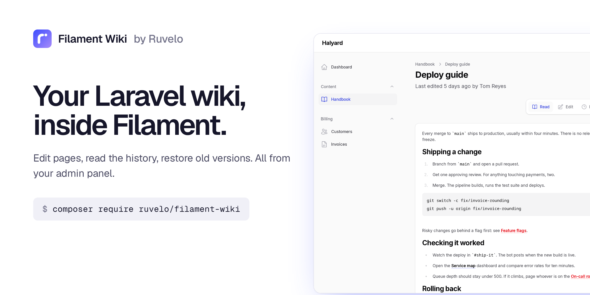
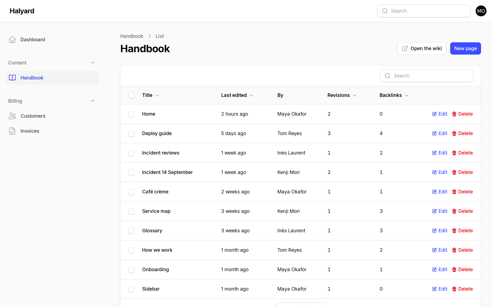
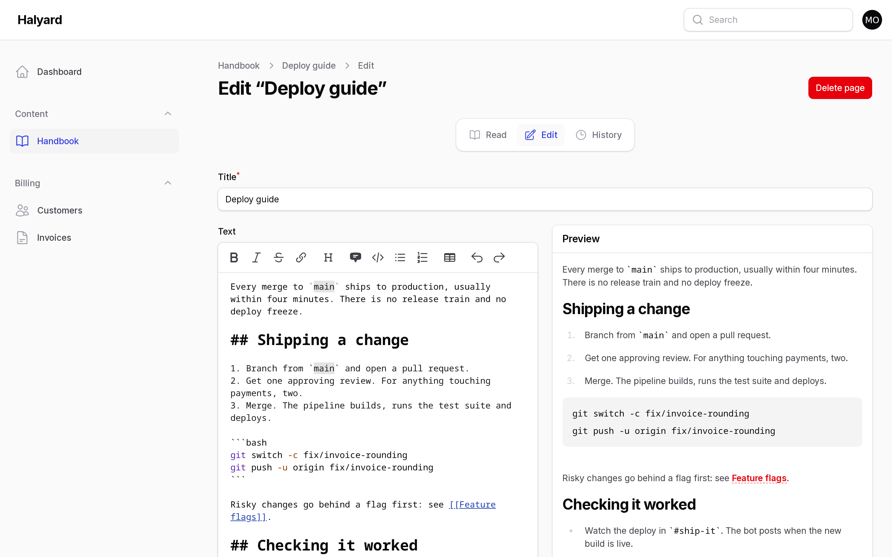
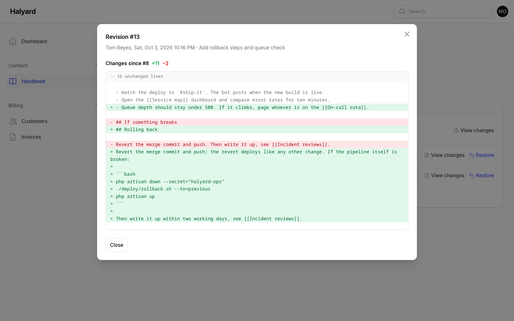
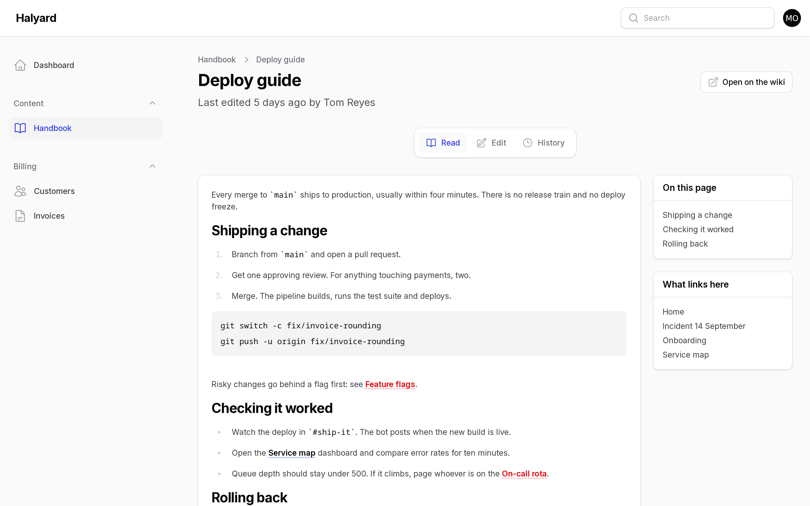
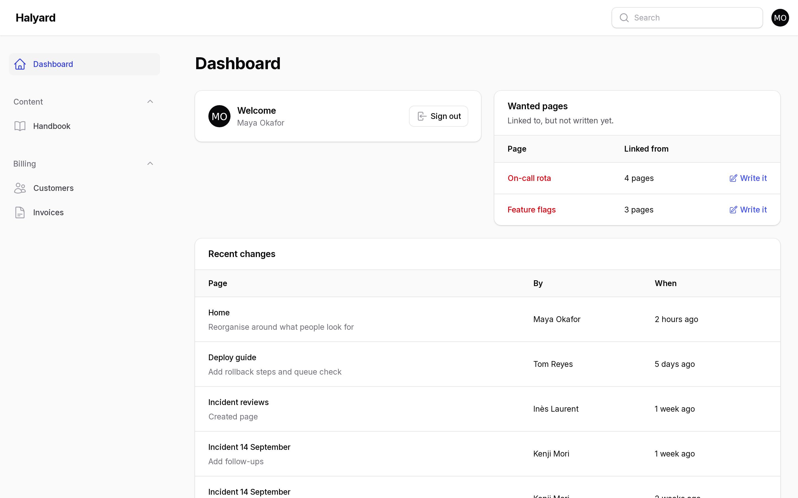
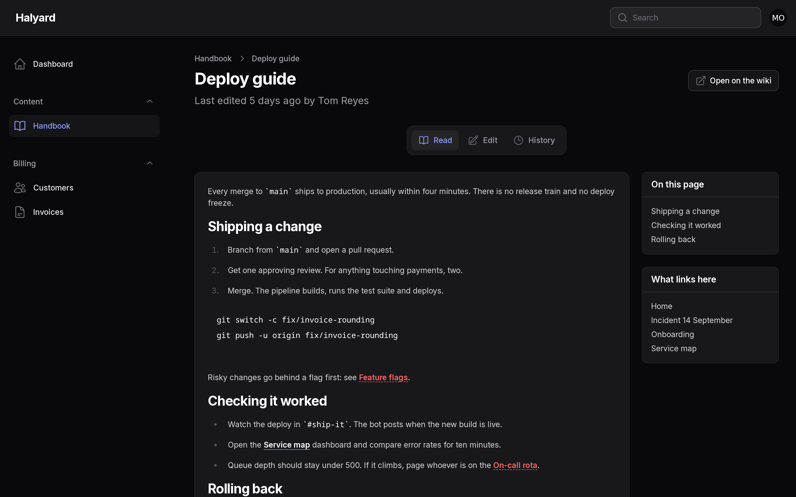

<p align="center">
  <a href="https://ruvelo.github.io/filament-wiki/"></a>
</p>

<p align="center">
  <a href="https://ruvelo.github.io/filament-wiki/"><strong>Live demo</strong></a> &nbsp;&nbsp;&nbsp;
  <a href="#configuration"><strong>Configuration</strong></a> &nbsp;&nbsp;&nbsp;
  <a href="#for-developers"><strong>Developer guide</strong></a> &nbsp;&nbsp;&nbsp;
  <a href="CHANGELOG.md"><strong>Changelog</strong></a>
</p>

<p align="center">
  <a href="https://github.com/Ruvelo/filament-wiki/actions/workflows/tests.yml"></a>
  
  
  
  
  <a href="LICENSE"></a>
</p>

# Filament Wiki

**Your [Laravel Wiki](https://github.com/Ruvelo/laravel-wiki), inside your Filament admin panel.** Edit pages with a live preview, read the history, restore old versions and see which pages people are waiting for. Same pages, same history and same links as the wiki: this plugin adds no tables of its own.

```
composer require ruvelo/filament-wiki
php artisan migrate
```

Then add `WikiPlugin::make()` to your panel (see [Install](#install)). Filament panels need a server, so the [live demo](https://ruvelo.github.io/filament-wiki/) is a gallery of screenshots; [the wiki's own demo](https://ruvelo.github.io/laravel-wiki/) is the real thing.

## A quick tour



**Every page at a glance.** Who touched it last, how often it changed, and how many pages link to it. Search covers titles and text.



**Write with a live preview.** Filament's Markdown editor beside the page as the wiki renders it: `[[links]]` resolve as you type, and pages that don't exist yet show in red.



**See what changed, and undo it.** Every revision with its author and edit summary, a line diff for each, and Restore.



**Read it like the wiki.** The rendered page with its outline and what links here. Links stay inside the panel.

<table>
  <tr>
    <td width="50%"></td>
    <td width="50%"></td>
  </tr>
  <tr>
    <td><strong>On the dashboard</strong>: recent changes, and the red links most worth writing.</td>
    <td><strong>Filament's own look</strong>, in light and dark, in your panel's colours.</td>
  </tr>
</table>

## Features

- **A Pages resource**: title, last edited, last editor, revision count and backlink count. Search titles and text, sort by any of them, delete one or many (with confirmation).
- **Split editor**: Filament's Markdown editor on the left, a live preview on the right rendered by the wiki itself, red links included. Add an edit summary for the history.
- **One write path**: every save goes through the wiki's `Page::draft()` and `commit()`, so each records a revision, re-indexes links and fires the wiki's `PageSaved` event, exactly as saving on the wiki does.
- **No lost edits**: the editor remembers the revision it started from. If someone saves in the meantime, your save is refused with a clear notification, and your text stays in the editor.
- **History**: every revision with its author and summary, a line diff for each, and Restore, which saves the old version as a new revision (so a restore can be undone too).
- **Reader**: the page as the wiki renders it, with an outline, what links here, and a button to open it on the public wiki. `[[Links]]` stay in the panel; red links open the create form with the title filled in.
- **Dashboard widgets**: Recent changes, and Wanted pages: the red links, most linked first, with a button to write each.
- **Your rules for editing**: the wiki's `wiki-edit` gate by default, or any closure. Everyone who can use the panel can read.
- **Filament 4 and 5**, Laravel 12 and 13. Built from Filament's own components and colours; no Tailwind build step, no custom theme needed.
- **Safe to render**: the wiki escapes raw HTML and drops `javascript:` links, in the reader, the preview and the diffs.
- **Coding agents** using [Laravel Boost](https://laravel.com/docs/boost) learn how to register and use the plugin.

## Requirements

- PHP 8.3+
- Laravel 12 or 13
- Filament 4 or 5
- [ruvelo/laravel-wiki](https://github.com/Ruvelo/laravel-wiki) 1.1+ (installed for you)

## Install

```
composer require ruvelo/filament-wiki
php artisan migrate
```

The migration is the wiki's. Then register the plugin in your panel provider:

```php
use Ruvelo\FilamentWiki\WikiPlugin;

public function panel(Panel $panel): Panel
{
    return $panel
        // ...
        ->plugin(WikiPlugin::make());
}
```

A **Wiki** item appears in the navigation, and two widgets on the dashboard. The public wiki at `/wiki` keeps working alongside; see the [wiki's docs](https://github.com/Ruvelo/laravel-wiki#configuration) to configure or turn it off.

## Who can edit

By default the panel follows the wiki: **anyone who can use the panel can read, and editing needs the `wiki-edit` gate** (any signed-in user when no gate is defined). Define the gate once and it applies to both the panel and the public wiki:

```php
Gate::define('wiki-edit', fn ($user) => $user->is_admin);
```

Or decide for the panel alone:

```php
WikiPlugin::make()->canEdit(fn ($user) => $user->hasRole('editor'));
```

Editing means creating, editing, deleting and restoring. People who can't edit still see the pages, the reader and the history, without the buttons. Model policies for wiki pages are not consulted.

## Configuration

Everything is set on the plugin, per panel:

```php
WikiPlugin::make()
    ->navigationGroup('Content')
    ->navigationLabel('Handbook')
    ->slug('handbook')
    ->wantedPagesWidget(false);
```

| Method | Default | |
|---|---|---|
| `navigationGroup()` | none | Navigation group: a string, an enum or a closure |
| `navigationLabel()` | `Wiki` | Label in the navigation, and the list page's title |
| `navigationIcon()` | `Heroicon::OutlinedBookOpen` | Any Filament icon |
| `navigationSort()` | none | Position in the navigation |
| `slug()` | `wiki` | URL segment: `/admin/wiki` |
| `canEdit()` | the `wiki-edit` gate | `bool` or a closure given `$user` |
| `reader()` | `true` | The Read page. Off: rows open the editor |
| `publicLink()` | `true` | "Open the wiki" and "Open on the wiki" buttons, shown only while the wiki's routes are registered |
| `recentChangesWidget()` | `true` | The Recent changes widget on the dashboard |
| `wantedPagesWidget()` | `true` | The Wanted pages widget on the dashboard |
| `widgets()` | `true` | Both widgets at once |

Wiki settings (table prefix, the author model and name attribute, Markdown extensions, the menu page) live in the wiki's `config/wiki.php` and apply here too.

### URLs

With the default panel path and slug:

| | |
|---|---|
| `/admin/wiki` | All pages |
| `/admin/wiki/_/new` | New page (`?title=` to pre-fill) |
| `/admin/wiki/{slug}` | Read a page |
| `/admin/wiki/{slug}/edit` | Edit |
| `/admin/wiki/{slug}/history` | Revisions, diffs and restore |

`_/new` can never collide with a page: slugs never contain an underscore.

## Customising the look

The plugin is built from Filament's own components, so it takes on your panel's colours, font and dark mode. Ruvelo's suggested primary is ultramarine. `Color::hex('#3D4EFF')` builds a lighter palette around it, so pass the shades with `#3D4EFF` at 600 to get ultramarine buttons:

```php
$panel->colors([
    'primary' => [
        50 => '#EEF0FF', 100 => '#E0E3FF', 200 => '#C7CCFF', 300 => '#A5ADFF', 400 => '#8F9BFF', 500 => '#6573FF',
        600 => '#3D4EFF', 700 => '#2F3DE0', 800 => '#2733B5', 900 => '#232D8C', 950 => '#1E2150',
    ],
]);
```

Rendered pages use Filament's `fi-prose` styles. The few things Filament has no class for (red links, the diff, the outline) are styled in one small `<style>` added to panels that use the plugin, scoped to `fi-wiki-*` and built on the theme's colour variables. To change them, or the diff's markup, publish the views:

```
php artisan vendor:publish --tag=filament-wiki-views
```

They land in `resources/views/vendor/filament-wiki`: `styles.blade.php` and `diff.blade.php`.

## For developers

### PHP API

The plugin's own API is small:

```php
use Ruvelo\FilamentWiki\Resources\PageResource;
use Ruvelo\FilamentWiki\Support\WantedPages;
use Ruvelo\FilamentWiki\WikiPlugin;

WikiPlugin::get();                                     // the plugin on the current panel
WikiPlugin::get()->userCanEdit($user);                 // the panel's edit check
PageResource::getUrl('view', ['record' => $page]);     // reader URL ('edit', 'history', 'create', 'index')
PageResource::getUrl('create', ['title' => 'Runbook']);
PageResource::prose($markdown);                        // rendered by the wiki, links pointing into the panel
WantedPages::top(10);                                  // red links: slug, title as written, linking pages
```

For pages themselves, use the wiki's API: `Wiki::write()`, `Wiki::find()`, `$page->commit()` and friends. See [the wiki's developer guide](https://github.com/Ruvelo/laravel-wiki#for-developers).

### Classes you can extend or reuse

| Class | What it is |
|---|---|
| `Resources\PageResource` | The resource: table, form, authorisation |
| `Resources\PageResource\Pages\ListPages`, `CreatePage`, `EditPage`, `ReadPage`, `PageHistory` | Its pages |
| `Widgets\RecentChanges`, `Widgets\WantedPages` | The dashboard widgets; add them to other pages with `->widgets([...])` |

All under `Ruvelo\FilamentWiki`. Action names, for tests and customisation: `changes` and `restore` on the history table, `write` on Wanted pages, `openWiki` on the list, `openOnWiki` on the reader.

### JSON API, events, exceptions

The plugin adds no routes outside the panel and no JSON API: for React, Vue or Inertia front ends, use [the wiki's JSON API](https://github.com/Ruvelo/laravel-wiki#json-api). Every change made in the panel fires the wiki's events, so your listeners see them:

| Event | When |
|---|---|
| `Ruvelo\Wiki\Events\PageSaved` | A page is created, edited or restored |
| `Ruvelo\Wiki\Events\PageDeleted` | A page and its history are deleted |

The panel turns the wiki's exceptions into messages people can act on: `EditConflict` becomes a "Someone else edited this page" notification; a duplicate or invalid title is a form error before the wiki is asked, and a notification if someone else creates the same page mid-save (`PageAlreadyExists`). All of the wiki's exceptions extend `Ruvelo\Wiki\Exceptions\WikiException`.

### In your tests

Create pages with the wiki's factory, then test the panel pages with Filament's helpers:

```php
use Ruvelo\FilamentWiki\Resources\PageResource\Pages\EditPage;
use Ruvelo\Wiki\Models\Page;

$page = Page::factory()->titled('Deploy guide')->create(); // with a revision and indexed links

Livewire::actingAs($editor)
    ->test(EditPage::class, ['record' => $page->slug])
    ->fillForm(['body' => 'New text', 'summary' => 'Rewrite'])
    ->call('save')
    ->assertNotified('Page saved');
```

### Laravel Boost

The package ships [Boost](https://laravel.com/docs/boost) guidelines in `resources/boost/guidelines/core.blade.php`. Run `php artisan boost:install` (or `boost:update`) and coding agents learn how to register the plugin, the single write path, and what not to do.

## Contributing

Pull requests are welcome. Clone, `composer install`, then `composer check` runs code style (Pint), static analysis (PHPStan level 8) and the tests, exactly as CI does. See [CONTRIBUTING.md](CONTRIBUTING.md) and the [changelog](CHANGELOG.md).

The screenshots come from a real panel: `demo/screenshots.sh` seeds a Halyard admin panel, serves it on port 8940 and regenerates `art/`; `composer demo` builds the gallery site into `build/`.

## Credits

Built by [François Bultez](https://github.com/francoisbultez) at [Valtry](https://valtry.co.uk/?utm_source=ruvelo&utm_medium=github&utm_campaign=filament-wiki), the website security scanner, and everyone who contributes.

## License

MIT. See [LICENSE](LICENSE).
